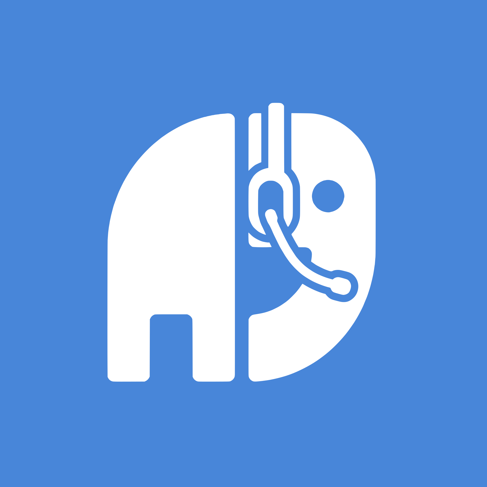

# Nomla

Nomla is a [Mumble](https://www.mumble.info/) voice-chat client for Android. It
runs on Android 12 (API 31) and later.
Website: https://becker.koeln/nomla/

Nomla was ported from [Mumla](https://gitlab.com/quite/mumla) and almost
completely rewritten, from Java to Kotlin. Credit goes to the projects it comes
from:

- [Mumla](https://gitlab.com/quite/mumla) and its protocol library
  [Humla](https://gitlab.com/quite/humla), by Daniel Lublin and contributors;
- [Plumble](https://github.com/acomminos/Plumble) and
  [Jumble](https://github.com/acomminos/Jumble), which Mumla and Humla continue,
  by Andrew Comminos and contributors.

See [AUTHORS](AUTHORS) and [NOTICE](NOTICE) for details.

*In memory of Andreas Mandalka (Natenom), whose guides, servers and patience
helped so many people find their way to Mumble.*

## Building

The supported development environment is the Nix flake in this repository.
With [Nix](https://nixos.org/) installed and flakes enabled:

    git clone --recursive https://github.com/devfbe/nomla.git
    cd nomla
    nix develop

The shell provides JDK 21, the Android SDK (platform 37.0, build-tools 37.0.0),
NDK 29.0.14206865 and SDK CMake 4.1.2 for the Android build, a host C/C++
compiler with CMake and Ninja for the native host tests, `git` and Python.
Inside it:

    ./gradlew assembleFossDebug      # the app (Google Play, F-Droid, website)
    ./gradlew assembleBetaDebug      # the side-by-side beta (koeln.becker.nomla.beta)
    ./gradlew :libraries:core:nativeHostTests   # native tests on the host, plain and ASan/UBSan
    ./gradlew verify                 # the pre-merge check

`verify` assembles the foss and beta debug and the foss release builds;
runs the JVM unit tests (JUnit, Robolectric) of every module, the app's for foss
debug only since the flavors share one test source set; builds the native tests
for the host and runs them with ctest, also under ASan/UBSan; builds the device
tests (running them needs a device); lints the foss and beta debug variants
and `libraries/core`; and runs detekt against each module's
baseline. CI runs exactly this.

If you cloned without `--recursive`, run `git submodule update --init --recursive`
first. `libraries/core` is an ordinary directory in this repository, not a
submodule; the submodules are the third-party native sources under
`libraries/core/src/main/cpp/third_party/` — the Opus codec and the audio
processing libraries speexdsp, RNNoise, webrtc-audio-processing and its
dependency abseil-cpp — built for
`arm64-v8a`, `armeabi-v7a` and `x86_64` via CMake with hand-written JNI glue.

[direnv](https://direnv.net/) users can `direnv allow` to enter the shell
automatically. `nix run .#android-studio` starts Android Studio with the same
SDK and NDK. The same shell is what CI uses (`.github/workflows/verify.yml`).

If you get an error running out of Java heap space, try raising the `-Xmx` in
`gradle.properties`.

## Repository layout

- `app/` — the Android application, product flavors `foss` (`koeln.becker.nomla`,
  the one release build for Google Play, F-Droid and the website; no in-app
  purchases or donations) and `beta` (`koeln.becker.nomla.beta`, a test app
  installed alongside it).
- `libraries/protocol/` — the platform-free half of the Mumble library, a plain
  Kotlin/JVM module: the Mumble protocol (`src/Mumble.proto` and
  `src/MumbleUDP.proto` are compiled to Java at build time; nothing generated
  is checked in), TLS/UDP transports, OCB2 crypto (BouncyCastle), the model
  snapshots and the log facade. No `android.*` is on its classpath; its tests
  are plain JUnit.
- `libraries/core/` — the Android half (`koeln.becker.nomla.mumble`): the session, the
  audio pipeline and routing; `src/main/cpp/CMakeLists.txt` builds the native
  codecs and audio processing libraries and their JNI glue.
- `build-logic/` — Gradle convention plugins with the Android and JVM
  configuration shared by the modules; dependency versions live in
  `gradle/libs.versions.toml`.
- `branding/` — the logo (`nomla.svg`, a 512×512 PNG for stores, and the original
  artwork).
- `website/` — the project website at https://becker.koeln/nomla/ (static, German
  and English).
- `NOTICE.md` — third-party components and licenses.
- `docs/audio-testing.md` — the audio test suite: what each test proves, the Piper
  speech corpus, how to run the device and room tests, and what they measured.

## Contributing

- **Tests first.** Every behavior change starts with a failing JVM test
  (JUnit 4, Robolectric for Android classes, MockK, Google Truth,
  `kotlinx-coroutines-test`); native code stays a thin JNI pass-through and
  the Kotlin side is tested against fakes. `./gradlew verify` must be green.
- **Kotlin.** New files are Kotlin; a Java file you change substantially is
  converted first, as its own commit.
- **Conventional Commits**, in English: `feat:`, `fix:`, `refactor:`,
  `build:`, `test:`, `docs:`, `chore:`, `l10n:`, optional scope such as
  `fix(core):`, imperative subject of at most 72 characters.
- **Strings**: English texts live in `app/src/main/res/values/` (`strings.xml`,
  `preference.xml`) and `libraries/core/src/main/res/values/strings.xml`. The
  translations in the `values-*` directories are maintained in this repository;
  a change to an English string updates every locale, in a separate `l10n:`
  commit.

## FAQ

**An action my user has permission for does not show up in the overflow menu.**
Disconnect and reconnect. Menu items are decided from the permissions known
when the UI was set up and are not updated while connected.

## License

Nomla is free software: GNU GPL v3 or later, see [LICENSE](LICENSE). Third-party
notices are in [NOTICE](NOTICE) and [NOTICE.md](NOTICE.md).
